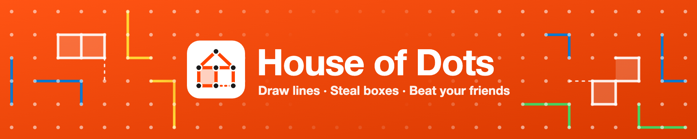
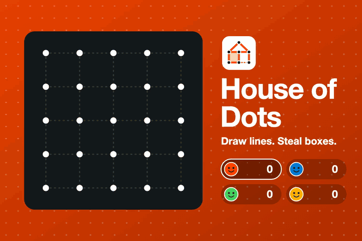

<p align="center">
  
</p>

<p align="center">
  <a href="https://www.reddit.com/r/house_of_dots/"></a>
  <a href="https://developers.reddit.com/apps/house-of-dots"></a>
  <a href="https://github.com/redchief/house-of-dots/actions/workflows/ci.yaml"></a>
  <a href="LICENSE"></a>
</p>

<p align="center">
  <b>The dots and boxes game you played in the back of your school notebook, now live on Reddit.</b><br />
  Play randoms or invite friends, claim boxes with your Reddit avatar, and climb your community's leaderboard.
</p>

<p align="center">
  
</p>

---

## 🎮 Play

**👉 [r/house_of_dots](https://www.reddit.com/r/house_of_dots/)**: open the pinned post and tap **Play**.

House of Dots runs inside Reddit, in the feed and in the app, so there's nothing to download and no account to create.

## 📏 How to play

1. Players take turns drawing **one line** between two neighbouring dots, horizontally or vertically.
2. If your line closes the **fourth side of a box**, the box is yours: your Reddit avatar is stamped inside it, and **you go again**.
3. When every line is drawn, the player with the **most boxes wins**.

> **Tip:** Don't draw the third side of a box. Your opponent will just close it, and maybe a whole chain after it.

## ✨ Features

| | |
|---|---|
| ⚡ **Quick match** | Jump into a game with random redditors. If not enough people join within 20 seconds, bots fill the empty seats. |
| 🔒 **Private rooms** | Share a 6-letter code, or invite friends by username and they get a Reddit message with the code. |
| 🖼️ **Avatar boxes** | Every box you capture shows your Reddit avatar. |
| 📐 **Three board sizes** | 4×4, 6×6 or 8×8 boxes, for 2 to 4 players. |
| ⏱️ **Turn timer** | 30 seconds per turn. Go AFK for three turns and a bot takes your seat, so games never stall. |
| 🔁 **Rematch** | Play again with the same group in one tap. |
| 🏆 **Leaderboards** | Each community has its own leaderboard for wins and for boxes captured. |
| 🌗 **Light and dark mode** | Follows your device's light or dark setting. |

## 🛠️ Add it to your community

Moderators can install House of Dots in any subreddit:

1. Open the app in the [Reddit App Directory](https://developers.reddit.com/apps/house-of-dots) and click **Add to community**.
2. Installing creates a game post automatically. To add more, use **Create a new post** in your subreddit's mod menu.

A single post holds every match and private room, so your feed stays clean.

## 🔐 Privacy

The game stores your username, your avatar link and game data. Game data is deleted after 24 hours, and leaderboard scores are kept per community. No data leaves Reddit, and there are no ads or tracking. For details, see the [privacy policy](docs/privacy.md) and the [terms](docs/terms.md).

---

## 🧑‍💻 Development

House of Dots is a [Devvit Web](https://developers.reddit.com/) app.

| Layer | Stack |
|---|---|
| Client | React 19, Tailwind CSS 4, Vite, rendered inside Reddit's webview |
| Server | Node 24 serverless on Devvit, Hono, tRPC 11 |
| Data and live updates | Devvit Redis (game state, leaderboards), Devvit Realtime (move sync) |
| Tests | Vitest, using Devvit's test harness for the server |

### Quick start

```bash
git clone https://github.com/redchief/house-of-dots.git
cd house-of-dots
nvm use              # Node 24.18.0, from .nvmrc
npm install
npm run login        # connect the Devvit CLI to your Reddit account
npm run dev          # playtest on your own test subreddit
```

You'll need a small **private** subreddit of your own to playtest in. See [CONTRIBUTING.md](CONTRIBUTING.md#playtesting).

### Scripts

| Command | What it does |
|---|---|
| `npm run dev` | Playtest live on Reddit (`devvit playtest`) |
| `npm run test` | Type-check, lint, unit tests and build (the same checks CI runs) |
| `npm run test:unit` | Unit tests only |
| `npm run build` | Build the client and server into `dist/` |
| `npm run deploy` | Upload a new version (maintainers only) |
| `npm run launch` | Publish a version for Reddit review (maintainers only) |

### Project layout

```text
src/
├── shared/game.ts        # all game rules, pure functions, unit-tested
├── server/
│   ├── trpc.ts           # API routes; every one checks who is calling
│   ├── core/actions.ts   # quick match, rooms, moves, timeouts, rematch, invites
│   ├── core/room.ts      # Redis storage with optimistic locking, realtime broadcasts
│   └── core/leaderboard.ts
└── client/
    ├── splash.tsx        # lightweight feed preview
    ├── game.tsx          # lobby → waiting room → game → results
    └── Board.tsx         # SVG board
assets/reddit/            # logo, banners and promo art; regenerate with render-promo.sh
docs/                     # privacy policy and terms
```

**How a move works:** the client sends `room.move`. The server checks the move, applies the rules in `shared/game.ts`, plays any bot turns, and saves the room using Redis `WATCH`/`MULTI`, so two moves arriving at once can't both apply. The server then broadcasts the new state over Devvit Realtime to everyone in the room. Clients never decide the outcome of a move.

## 🤝 Contributing

Bug reports, ideas and pull requests are welcome. Read **[CONTRIBUTING.md](CONTRIBUTING.md)** before opening a pull request.

- 🐛 **Bugs and feature ideas:** [GitHub Issues](https://github.com/redchief/house-of-dots/issues)
- 💬 **Gameplay feedback and community:** [r/house_of_dots](https://www.reddit.com/r/house_of_dots/)

## 📄 License

[BSD-3-Clause](LICENSE)
